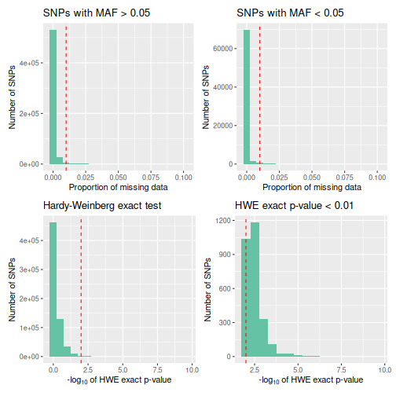
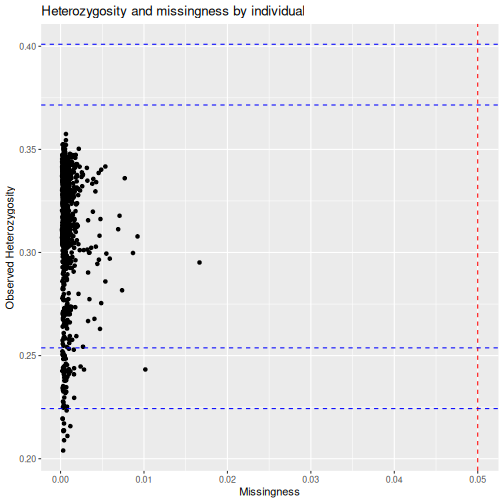
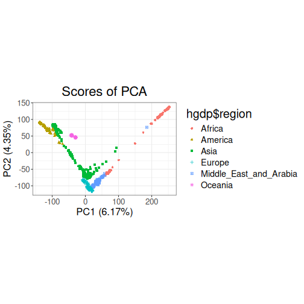
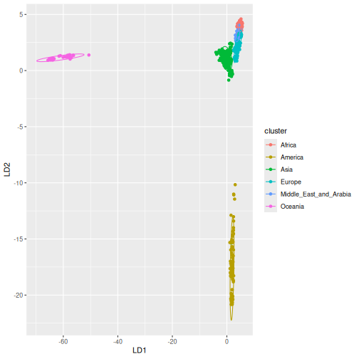
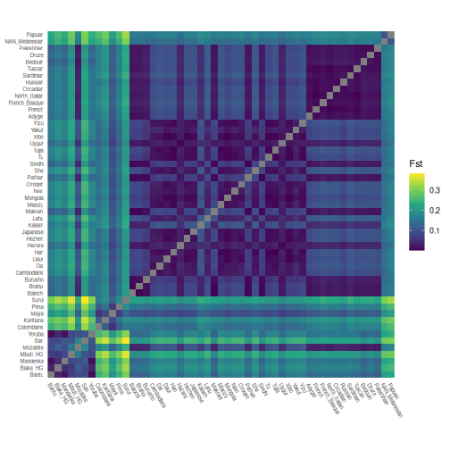

This vignette is a benchmark of a few key functions in the tidypopgen package.
The Human Genome Diversity Project (HGDP) SNP dataset is used for this
benchmark. This dataset includes 1043 individuals from 51 populations, typed
at ~650k loci.

We will run this benchmark on a machine with a GenuineIntel, 13th Gen Intel(R) Core(TM) i9-13900, 24 CPU
and 126 GiB of RAM. However, we will limit the number of
cores used to 20. Parallelised functions within tidypopgen use an
`n_cores` argument for the user to set. However, to prevent a behind-the-scenes
inflation of the number of threads used (for example, in cases where dependency
functions may automatically use all available cores) we need to set up
preferences at the beginning of the session. Specifically, we limit the
number of cores used by the parallelised BLAS library with
`bigparallelr::set_blas_ncores()`, and by the package data.table with
`data.table::setDTthreads()`.


``` r
n_cores <- 20

data.table::setDTthreads(n_cores)
bigparallelr::set_blas_ncores(n_cores)
```

We can now load the necessary libraries:


``` r
library(tidypopgen)
#> Loading required package: dplyr
#> 
#> Attaching package: 'dplyr'
#> The following objects are masked from 'package:stats':
#> 
#>     filter, lag
#> The following objects are masked from 'package:base':
#> 
#>     intersect, setdiff, setequal, union
#> Loading required package: tibble
library(ggplot2)
```

And before running the benchmark, we need to download the relevant files. We
can use the following to download the HGDP files into a temporary directory:


``` r
temp_dir <- tempdir()
download_url <- "https://zenodo.org/records/15582364/files/hgdp650_id_pop.txt"
download_path <- file.path(temp_dir, "hgdp650_id_pop.txt")
download.file(download_url, download_path, mode = "wb")
download_url <- "https://zenodo.org/records/15582364/files/hgdp650.qc.hg19.bed"
download_path <- file.path(temp_dir, "hgdp650.qc.hg19.bed")
download.file(download_url, download_path, method = "wget")
download_url <- "https://zenodo.org/records/15582364/files/hgdp650.qc.hg19.bim"
download_path <- file.path(temp_dir, "hgdp650.qc.hg19.bim")
download.file(download_url, download_path, method = "wget")
download_url <- "https://zenodo.org/records/15582364/files/hgdp650.qc.hg19.fam"
download_path <- file.path(temp_dir, "hgdp650.qc.hg19.fam")
download.file(download_url, download_path, method = "wget")
```

In the following vignette, we place these files into the subdirectory
`data/hgdp/`, and we will use the paths to the bed file `hgdp650.qc.hg19.bed`
and the metadata file `hgdp650_id_pop.txt` to read in our data. We make the
column names of the metadata lower case, as are those of the `gen_tibble`:


``` r
bed_path <- "./data/hgdp/hgdp650.qc.hg19.bed"
meta_info <- readr::read_tsv("./data/hgdp/hgdp650_id_pop.txt") %>%
  rename_with(tolower)
#> Rows: 1064 Columns: 6
#> ── Column specification ────────────────────────────────────────────────────────
#> Delimiter: "\t"
#> chr (6): Id, Sex, population, Geographic_origin, Region, Pop7Groups
#> 
#> ℹ Use `spec()` to retrieve the full column specification for this data.
#> ℹ Specify the column types or set `show_col_types = FALSE` to quiet this message.
```

# Create gen_tibble object

Our first step is to load the HGDP data into a `gen_tibble` object, and add its
associated metadata.


``` r
hgdp <- gen_tibble(bed_path,
  quiet = TRUE,
  backingfile = tempfile("test_"),
  n_cores = n_cores
)
```

read_plink: 1.2s

Add metadata


``` r
hgdp <- hgdp %>% mutate(
  population = meta_info$population[match(hgdp$id, meta_info$id)],
  region = meta_info$region[match(hgdp$id, meta_info$id)]
)
```

Let's confirm that we have read all the expected information:


``` r
hgdp
#> # A gen_tibble: 643733 loci
#> # A tibble:     1,043 × 5
#>    id        phenotype  genotypes population region
#>    <chr>     <fct>     <vctr_SNP> <chr>      <chr> 
#>  1 HGDP00448 control    [2,0,...] Biaka_HG   Africa
#>  2 HGDP00479 control    [1,0,...] Biaka_HG   Africa
#>  3 HGDP00985 control    [0,0,...] Biaka_HG   Africa
#>  4 HGDP01094 control    [1,0,...] Biaka_HG   Africa
#>  5 HGDP00982 control    [2,0,...] Mbuti_HG   Africa
#>  6 HGDP00911 control    [1,0,...] Mandenka   Africa
#>  7 HGDP01202 control    [2,0,...] Mandenka   Africa
#>  8 HGDP00927 control    [2,0,...] Yoruba     Africa
#>  9 HGDP00461 control    [2,0,...] Biaka_HG   Africa
#> 10 HGDP00451 control    [2,0,...] Biaka_HG   Africa
#> # ℹ 1,033 more rows
```

As this dataset includes information from multiple populations, we want to
group the gen_tibble, so that quality control and the population statistics
below work within populations:


``` r
hgdp <- hgdp %>%
  group_by(population)
```


# Loci Report

We can then call `qc_report_loci`. This function supplies minor allele
frequency, rate of missingness, and a Hardy-Weinberg exact p-value for each SNP.
As `hgdp` is grouped, Hardy-Weinberg equilibrium is tested within each
population (with a Bonferroni correction across populations), while the minor
allele frequency and the missingness are computed over all individuals.


``` r
loci_report <- qc_report_loci(hgdp)
```

loci_report: 133ms
The resulting report can be observed using `autoplot`.


``` r
autoplot(loci_report, type = "all")
```



# Filter Loci

Following this, we filter the loci to only include those with a minor allele
frequency over 0.05, and a missingness rate below 0.05 (over all individuals).
We do not need to compute them again: the loci report has one row per locus,
in the same order as the loci of `hgdp`, so we can filter on its columns:


``` r
hgdp <- hgdp %>%
  select_loci_if(loci_report$maf > 0.05 & loci_report$missingness < 0.05)
```

filter_loci: 18ms


# Individual Report

We can then call `qc_report_indiv` to supply observed heterozygosity per
individual, and rate of missingness per individual.


``` r
indiv_report <- qc_report_indiv(hgdp)
```

indiv_report: 199ms


``` r
autoplot(indiv_report, type = "scatter")
```



# Filter individuals

And we can filter individuals down to only include those with less than 1% of
their genotypes missing. The individual report tells us how many individuals
we would keep and lose with this threshold:


``` r
indiv_report %>% count(lost = missingness >= 0.01)
#> # A tibble: 2 × 2
#>   lost      n
#>   <lgl> <int>
#> 1 FALSE  1041
#> 2 TRUE      2
```

The missingness of an individual does not depend on its group, but `filter()`
on a grouped `gen_tibble` evaluates its condition one group at a time (here,
one pass over the genotypes for each of the 51 populations). We thus ungroup
to filter, and group again afterwards:


``` r
hgdp <- hgdp %>%
  ungroup() %>%
  filter(indiv_missingness(genotypes) < 0.01) %>%
  group_by(population)
```

filter_indiv: 194ms

A few missing genotypes remain after filtering. We do not need to impute
them: LD clumping, the PCA and the DAPC below use, for each locus (or pair of
loci), the individuals genotyped at it (see the article on
[missing genotypes](missing_data.html)). Nor do we need to rewrite the backing
file with `gt_update_backingfile()` after filtering: the following steps only
use the individuals and loci that are left in the `gen_tibble`.

# LD clumping

LD clumping is then performed to control for linkage disequilibrium.


``` r
hgdp <- hgdp %>%
  select_loci_if(loci_ld_clump(genotypes, thr_r2 = 0.2, n_cores = n_cores))
```

ld_clumping: 464ms

# PCA

A principal components analysis can then be computed using the resulting cleaned
and LD clumped dataset.


``` r
test_pca <- hgdp %>% gt_pca(n_cores = n_cores)
```

pca: 951ms

Plot PCA:


``` r
autoplot(test_pca, type = "scores") +
  aes(color = hgdp$region, shape = hgdp$region)
```



# DAPC

We can continue with a discriminant analysis of principal
components using `gt_dapc`, setting 6 groups corresponding to
the main geographic regions covered by the dataset. As the PCA was computed
with missing genotypes, we also give the `gen_tibble` (`data`), which
`gt_dapc` uses to estimate the loadings of the loci.


``` r
test_dapc <- gt_dapc(test_pca,
  pop = as.factor(hgdp$region),
  data = hgdp, n_cores = n_cores
)
```

dapc: 133ms

Plot DAPC:


``` r
autoplot(test_dapc, type = "scores")
```



# Calculate Fst

To examine the differentiation between populations in the global HGDP set, we
calculate pairwise Fst between the populations that `hgdp` is grouped by.


``` r
pairwise_fsts <- hgdp %>% pairwise_pop_fst(
  n_cores = n_cores,
  type = "pairwise"
)
```

pairwise_fst: 54ms

Plot pairwise Fst:


``` r
# Order by continents
hgdp_order <- hgdp %>% arrange(region, population)
regional_order <- unique(hgdp_order$population)

autoplot(pairwise_fsts, order = regional_order) +
  scale_fill_viridis_c() +
  theme(
    axis.text.x = element_text(angle = -60, hjust = 0, size = 6),
    axis.text.y = element_text(angle = 0, hjust = 1, size = 6)
  ) +
  labs(
    x = NULL,
    y = NULL,
    fill = "Fst"
  )
```



# Save in plink bed format

Finally, we can save the resulting cleaned dataset to a PLINK .bed file.


``` r
gt_as_plink(hgdp,
  file = tempfile(),
  type = "bed",
  overwrite = TRUE
)
#> [1] "/tmp/RtmpPCGAJL/file2dbbf612ed7a7a.bed"
```

plink_save: 161ms

# Summary

Here is a summary of the time taken (in seconds) to perform each step of the analyses:


```
#>            step time
#> 1    read_plink 1.23
#> 2   loci_report 0.13
#> 3   filter_loci 0.02
#> 4  indiv_report  0.2
#> 5  filter_indiv 0.19
#> 6   ld_clumping 0.46
#> 7           pca 0.95
#> 8          dapc 0.13
#> 9  pairwise_fst 0.05
#> 10   plink_save 0.16
#> 11        Total 3.52
```
# Running the benchmark on a laptop
We will now run this benchmark on a laptop 
with a GenuineIntel, Intel(R) Core(TM) Ultra 7 155H, 22 CPU
and 31 GiB
of RAM, limiting the number of cores to 4.
Here is a summary of the time taken (in seconds) to perform each step of the analyses:


```
#>            step  time
#> 1    read_plink  2.01
#> 2   loci_report  0.11
#> 3   filter_loci  3.17
#> 4  indiv_report  0.37
#> 5  filter_indiv  0.01
#> 6        impute  0.96
#> 7   ld_clumping  6.83
#> 8           pca  5.06
#> 9          dapc  0.32
#> 10 pairwise_fst  0.33
#> 11   plink_save   0.3
#> 12        Total 19.47
```
