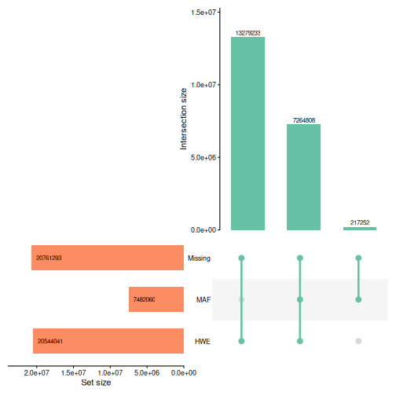
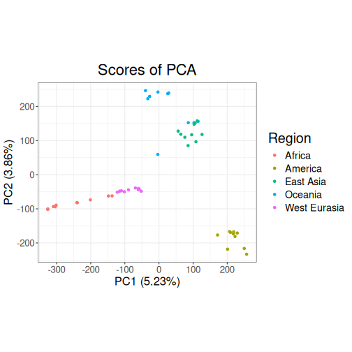
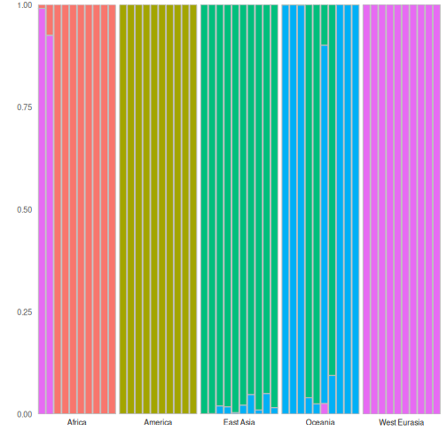
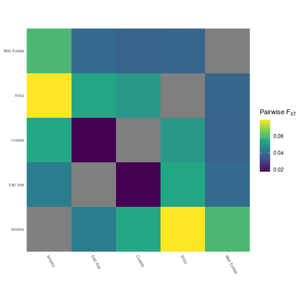

This vignette will demonstrate how to work with large datasets in tidypopgen,
including whole-genome data. For this type of data, tidypopgen implements an
option to minimise the memory footprint of very large datasets. As a large
chunk of memory is occupied by loci names, loci names can be stored as
integers rather than character strings (with `names_as_int = TRUE`),
reducing the memory used by the gen_tibble object. This is the default
of `gt_merge_vcfs()`, which we use below to merge many VCF files into
a single gen_tibble, and an option of `gen_tibble()`.

*Note* that tidypopgen only handles variant sites,
so if you are using a whole-genome dataset make sure it has been previously
subsetted to variant sites only. Think very carefully before merging this
kind of data during your pipeline!
# Getting the data

## Downloading the SGDP data

We will demonstrate the new capacity of tidypopgen using a subset of the [Simons Genome Diversity Project (SGDP)](https://reichdata.hms.harvard.edu/pub/datasets/sgdp/), containing 10 individuals each from Africa, Oceania, America, West Eurasia and East Asia. The data are too large to download as part of this article, but the `create_sgdp_subset_*` scripts in the [`data-raw` folder](https://github.com/EvolEcolGroup/tidypopgen/tree/HEAD/data-raw) of the tidypopgen repository let you create the dataset yourself if you wish to follow along.

The 50 individuals are listed in the files `afr_subset.txt`, `oceania_subset.txt`, `america_subset.txt`, `west_eur_subset.txt` and `east_asia_subset.txt`, in `data-raw/data_files/sgdp`. These were created by `create_sgdp_subset_s01_metadata.R`, which takes the first 10 fully public individuals from each region in the SGDP metadata.

SGDP provides a VCF for each individual, but distributes them as a single 57 GB archive containing all 279 public individuals. The shell script `create_sgdp_subset_s02.sh` downloads only the parts of the archive that hold our 50 individuals (about 10.8 GB), and checks them against the checksums provided by SGDP. You will need `curl` installed and available on your `PATH`. From the root of a copy of the tidypopgen repository, run:


``` bash
bash data-raw/create_sgdp_subset_s02.sh vignettes/articles/data/sgdp
```

This writes the 50 VCFs to `vignettes/articles/data/sgdp/sgdp_vcfs/`, which is where we read them from below (the paths in this article are relative to `vignettes/articles/`). An interrupted download can be resumed by running the script again. We do not need any other tool: we merge the VCFs directly in R, with tidypopgen.

## Setting up

Now that we have our data we can begin by loading the necessary libraries:


``` r
library(tidypopgen)
#> Loading required package: dplyr
#> 
#> Attaching package: 'dplyr'
#> The following objects are masked from 'package:stats':
#> 
#>     filter, lag
#> The following objects are masked from 'package:base':
#> 
#>     intersect, setdiff, setequal, union
#> Loading required package: tibble
library(ggplot2)
```

Because tidypopgen utilizes disk storage through file-backed matrices (FBM), we can run the following pipeline on a modern laptop without running out of RAM. Here, we use a machine with a GenuineIntel, 13th Gen Intel(R) Core(TM) i9-13900, 24 CPU and 126 GiB of RAM.

Before we begin, we will limit the number of cores used by the parallelised BLAS library with `bigparallelr::set_blas_ncores()`, and by the package data.table with `data.table::setDTthreads()`. *Note* You may need to adjust `n_cores` according to your own hardware.


``` r
n_cores <- 20
data.table::setDTthreads(n_cores)
bigparallelr::set_blas_ncores(n_cores)
```

## Merging the VCFs into a gen_tibble

Each SGDP VCF only contains the sites at which that individual carries a non-reference allele. We merge them into a single `gen_tibble` with `gt_merge_vcfs()`, keeping all the sites found in any of the files (`variants = "union"`). A site that is absent from an individual's VCF is set to homozygous for the reference allele (`missing_to_ref = TRUE`, the equivalent of `bcftools merge --missing-to-ref`). Without this option, every homozygous reference genotype would be recorded as missing. The cost is that a site that was not sequenced in an individual is also set to homozygous reference, which is a reasonable approximation for these high-coverage genomes.

`gt_merge_vcfs()` reads each VCF twice: once to match its loci with those of the other files, and once to write its genotypes straight into the backing file of the merged `gen_tibble`, so that no merged VCF is ever written to disk. With `n_cores`, the bgzipped VCFs are decompressed, and their genotypes parsed, in parallel. (If your data are instead split by chromosome, with one VCF per chromosome for the same individuals, `gt_concat_vcfs()` reads them into a single `gen_tibble` in the same way, as `bcftools concat` would.)

In many descriptive population genetic analyses, where the end goal is to visualise populations (e.g., PCA) or calculate a summary statistic (e.g. F~ST~), the names of your loci are not needed for the analysis. In these cases, we can save a lot of memory (over half of the memory footprint of the `gen_tibble`) by switching the loci names from strings to integers. `gt_merge_vcfs()` does this by default (`names_as_int = TRUE`). *Note* that this differs from `gen_tibble()`, where `names_as_int` defaults to FALSE: to read a single large VCF with integer loci names, set `names_as_int = TRUE` in `gen_tibble()`. Conversely, set `names_as_int = FALSE` in `gt_merge_vcfs()` to keep the IDs (e.g. rsIDs) of the VCF files. The IDs are not lost with integer names: `gt_merge_vcfs()` writes them, with the chromosome and position of each locus, to a sidecar file next to the backing file (`.loci.tsv`), from which `gt_lookup_loci()` gives back the names of any loci (e.g. the hits of a scan), and `gt_restore_loci()` puts them back into the `gen_tibble` (see the article on [large RAD-seq datasets](rad_seq.html)).

For RAD-seq data assembled de novo, each RAD locus is its own chromosome, so the names of the chromosomes also take a lot of memory: set `chromosomes_as_int = TRUE` as well as `names_as_int = TRUE` (see the article on [large RAD-seq datasets](rad_seq.html)).


``` r
sgdp_files <- list.files("data/sgdp/sgdp_vcfs",
  pattern = "\\.vcf\\.gz$",
  full.names = TRUE
)
sgdp <- gt_merge_vcfs(sgdp_files,
  variants = "union",
  missing_to_ref = TRUE,
  backingfile = "data/sgdp/all_subset",
  n_cores = n_cores,
  quiet = TRUE
)
```

Merging the VCFs is the slowest step of this article (see the [performance summary](#performance-summary) at the end), but it only needs to be done once: the merged `gen_tibble` is saved alongside its backing file, and can be loaded again in a later session with `gt_load()`.


When we now call our loci tibble with `show_loci()`, we can see that the loci names are now integers:


``` r
show_loci(sgdp)
#> # A tibble: 20,761,293 × 7
#>    big_index  name chromosome position genetic_dist allele_ref allele_alt
#>        <int> <int> <fct>         <int>        <dbl> <chr>      <chr>     
#>  1         1     1 1             10109            0 A          T         
#>  2         2     2 1             10177            0 A          C         
#>  3         3     3 1             10180            0 T          C         
#>  4         4     4 1             10231            0 C          A         
#>  5         5     5 1             10234            0 C          G         
#>  6         6     6 1             10241            0 T          A         
#>  7         7     7 1             10248            0 A          T         
#>  8         8     8 1             10250            0 A          C         
#>  9         9     9 1             10255            0 A          T         
#> 10        10    10 1             10257            0 A          C         
#> # ℹ 20,761,283 more rows
```

The rsID's of each SNP have been removed, but all other metadata (chromosome, position, genetic distance, and alleles) are retained. We can check the memory footprint of the gen_tibble using:


``` r
format(object.size(sgdp), units = "auto", digits = 2)
#> [1] "792.01 Mb"
```

# Quality control for large datasets

## Individual and loci reports

All the normal functionality of tidypopgen is preserved, as our `qc_report` functions exemplify:


``` r
sgdp_indiv_rep <- qc_report_indiv(sgdp)
```


``` r
sgdp <- sgdp %>% group_by(Region)
sgdp_loci_rep <- qc_report_loci(sgdp)
sgdp <- sgdp %>% ungroup()
```

However, it is important to be mindful that analyses on very large datasets will produce large outputs:


``` r
format(object.size(sgdp_loci_rep), units = "auto", digits = 2)
#> [1] "554.39 Mb"
```

In this case, a loci report on 20761293 loci for 50 individuals occupies approximately 554.39 Mb of memory.

Let's plot the overview of the loci report:


``` r
autoplot(sgdp_loci_rep,
  maf_threshold = 0.05,
  miss_threshold = 0.05
)
```



We can see from the Upset plot above that MAF filtering will remove a large number of loci. WGS data require heavy filtering for MAF to avoid including uninformative loci in analyses (e.g. sequencing errors or private mutations).

On the other hand, no loci fail the missingness threshold. Because sites absent from an individual's VCF were set to homozygous reference when we merged the VCFs, there are no missing genotypes in this dataset. We can check the number of loci with any missing genotypes:


``` r
sum(sgdp_loci_rep$missingness > 0)
#> [1] 0
```

When objects are no longer needed, or once results outputs have been saved, we can remove them using `rm()` to keep memory usage under control:


``` r
rm(sgdp_loci_rep)
```

## Filtering

We can then proceed with basic data filtering in the same way as working with any other gen_tibble object.

We filter for minor allele frequency, choosing to select loci with MAF greater than 5%:


``` r
sgdp <- sgdp %>%
  select_loci_if(loci_maf(genotypes) > 0.05)
cat("Loci remaining:", count_loci(sgdp))
#> Loci remaining: 7482060
```

With other datasets, we would also remove loci with too many missing genotypes (e.g. with `select_loci_if(loci_missingness(genotypes) < 0.1)`), and then impute the remaining missing genotypes with `gt_impute_simple()`, as LD clumping and PCA do not accept missing values. Our dataset has no missing genotypes, so we can skip both steps. There is no need to rewrite the backing file with `gt_update_backingfile()` after filtering: the following steps only use the loci that are left in the `gen_tibble`.

## LD clumping

Then we can LD clump the dataset to remove loci in linkage disequilibrium.

With many loci, this step can be a little more time consuming, so it is important to remember to specify the `n_cores` parameter to speed things up:


``` r
sgdp <- sgdp %>%
  select_loci_if(loci_ld_clump(genotypes,
    n_cores = n_cores,
    thr_r2 = 0.2
  ))
cat("Loci remaining:", count_loci(sgdp))
#> Loci remaining: 511652
```

# Analysis

## PCA

Now that we have a clean dataset, we can proceed with our analysis by plotting a PCA:


``` r
sgdp_pca <- sgdp %>% gt_pca_partialSVD()
```


``` r
autoplot(sgdp_pca, type = "scores") +
  aes(colour = sgdp$Region) +
  labs(color = "Region")
```



Our PCA separates the five regions. PC1 (5.20% of the variance) runs from the American individuals on the left, through East Asia, Oceania and West Eurasia, to the African individuals on the right, and PC2 (3.85%) separates the American individuals at the top from the Oceanian and East Asian individuals at the bottom. The individuals from America, West Eurasia and East Asia form fairly tight clusters, whereas the African individuals are spread out along PC1: the Mbuti, Ju/'hoan North, Yoruba, Mandenka and Dinka individuals are on the far right, followed by the Masai and Somali individuals from East Africa, while the two Mozabite individuals from Algeria lie close to the West Eurasian cluster. This is consistent with North and East African populations carrying some West Eurasian-related ancestry. The Oceanian individuals are also spread out: the Papuan, Bougainville and Australian individuals are at the bottom, the Maori individual is closer to the centre of the plot, and the Hawaiian individual and the two Dusun individuals (from Borneo) lie within the East Asian cluster. This reflects the Austronesian ancestry of these populations, which is largely related to East Asian populations.

## DAPC

We can also perform a discriminant analysis of principal components (DAPC) using `gt_dapc`.


``` r
sgdp_dapc <- gt_dapc(sgdp_pca,
  pop = as.factor(sgdp$Region)
)
```


``` r
autoplot(sgdp_dapc, type = "components")
```



Our DAPC autoplot shows that most individuals are assigned to their own region's group with a probability close to one, showing that there is genetic differentiation between the continental regions. The exceptions are consistent with the PCA above: the two Mozabite individuals are assigned to the West Eurasian group (with probabilities of 0.93 and 0.99), the two Dusun individuals and the Hawaiian individual are assigned to the East Asian group (with probabilities of 0.96, 0.98 and 0.90), and the Maori individual has a probability of 0.09 of East Asian membership. These individuals may have admixed ancestry, or (as for the Dusun) be closer to the East Asian populations than to the other Oceanian populations in our sample.

# Pairwise F~ST~

Finally, to examine the differentiation between regions, we can calculate pairwise F~ST~.


``` r
grouped_sgdp <- sgdp %>% group_by(Region)
pairwise_fst <- grouped_sgdp %>% pairwise_pop_fst(
  n_cores = n_cores,
  type = "pairwise"
)

autoplot(pairwise_fst,
  order = function(x) {
    stats::hclust(stats::as.dist(x), method = "complete")
  }
) +
  scale_fill_viridis_c() +
  theme(
    axis.text.x = element_text(angle = -60, hjust = 0, size = 6),
    axis.text.y = element_text(angle = 0, hjust = 1, size = 6)
  ) +
  labs(
    x = element_blank(),
    y = element_blank(),
    fill = expression("Pairwise F"[ST])
  )
```



The pairwise F~ST~ values are all small (between 0.02 and 0.08), as is typical of human populations. America is the most differentiated region, and Africa and America are the most differentiated pair (F~ST~ = 0.079); America is closest to East Asia (0.044). East Asia and Oceania are the least differentiated pair (0.018), reflecting the East Asian-related ancestry of the Dusun, Hawaiian and Maori individuals in our Oceanian sample. Africa is closest to West Eurasia (0.038), which partly reflects the West Eurasian-related ancestry of the Mozabite, Somali and Masai individuals in our African sample. Note that with only 10 individuals per region, these estimates are imprecise.

# Performance summary

Here is a summary of the time taken (in seconds) by each step on our large dataset, and of the peak memory used by R during each step (in MB, including the objects that were already in memory, such as the `gen_tibble` itself):


```
#>                              step time_s peak_memory_mb
#> 1                      merge_vcfs  65.99           1991
#> 2                    indiv_report   0.44           1115
#> 3                     loci_report   0.28           1678
#> 4                      maf_filter   0.37           1969
#> 5                        ld_clump   8.56           2042
#> 6                             pca   0.66            979
#> 7                            dapc   0.03            415
#> 8                    pairwise_fst   0.17            374
#> 9 Total (time) / maximum (memory)  76.50           2042
```

The memory is measured with `gc()`, and only covers memory allocated by R. It does not include the genotypes, which stay in the backing file on disk (the operating system caches the parts that are read, but this cache can be freed whenever memory is needed), nor memory allocated directly by compiled code (for example, by the VCF parser while it reads the file).

# Key takeaways

- **Large data don't need a large machine.** `gen_tibble` objects are file-backed, so the genotypes stay on disk and only what you are working on is held in memory.
- **Merge many VCFs directly in R.** `gt_merge_vcfs()` (files with different individuals, as `bcftools merge`) and `gt_concat_vcfs()` (files with the same individuals and different chromosomes, as `bcftools concat`) read them straight into a single `gen_tibble`, without writing a merged VCF.
- **Use integer locus names** to reduce the memory they take. They are the default of `gt_merge_vcfs()` and `gt_concat_vcfs()`, while `gen_tibble()` needs `names_as_int = TRUE`. The original locus IDs are kept on disk, in a sidecar file next to the backing file, from which `gt_lookup_loci()` and `gt_restore_loci()` get them back; integer names can not be matched across datasets, so `rbind()` matches loci by chromosome and position.
- **Set your cores.** Limit BLAS and `data.table` threads at the start, and pass `n_cores` to the functions that support it (e.g. LD clumping and F~ST~).
- **Large analyses make large outputs.** Reports such as `qc_report_loci()` can be big, so save what you need and `rm()` the rest.
