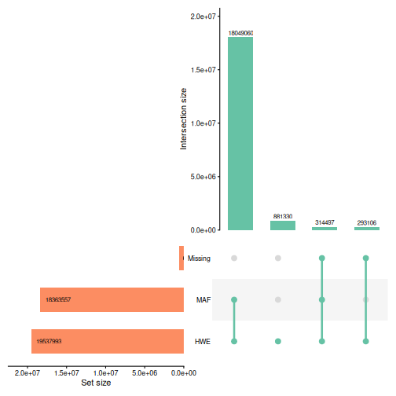
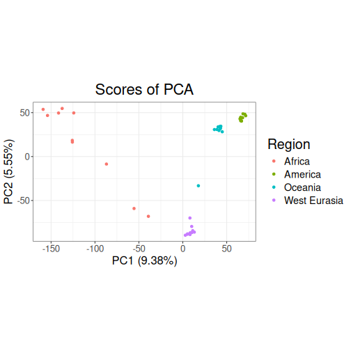
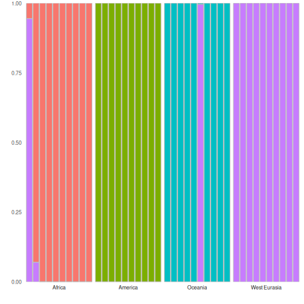
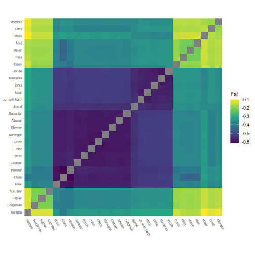

# Working with big data

This vignette will demonstrate how to work with large datasets in tidypopgen.

This includes whole-genome data. *Note* that tidypopgen only handles variant sites, so if you are using a whole-genome dataset make sure it has been previously subsetted to variant sites only. Think very carefully before merging this kind of data during your pipeline!

The latest version of tidypopgen has implemented a new option to minimise the memory footprint of very large datasets. As a large chunk of memory is occupied by loci names, the `gen_tibble()` function now offers the user the option to switch loci names from character strings to integers, reducing the memory used by the gen_tibble object. 

## Downloading the SGDP data

We will demonstrate the new capacity of tidypopgen using a small subset of the
[Simons Genome Diversity Project (SGDP)](https://reichdata.hms.harvard.edu/pub/datasets/sgdp/),
containing 10 individuals each from Africa, Oceania, America and West Eurasia.
Because the full dataset is large (279 individual VCF files), we do not
download it as part of the vignette. Instead, the code below shows how to
create the subset yourself if you wish to follow along. You will need
[bcftools](https://samtools.github.io/bcftools/) installed and available on
your `PATH`.

The shell script `data-raw/s02_create_sgdp_subset.sh` downloads the
SGDP archive, extracts only the individuals listed in the text files, and
uses `bcftools` to merge them into one VCF per region, plus a single VCF
containing all four regions (`all_subset.vcf.gz`):


``` bash
data-raw/s02_create_sgdp_subset.sh
```

Note that the download is large, so this step can take a while. The resulting
`.vcf.gz` files (and their `.tbi` indexes) are written to `data-raw/`.

## Setting up cores

Because tidypopgen utilizes disk storage through file-backed matrices (FBM), we can run this pipeline on a modern laptop without running out of RAM. Here, we use a GenuineIntel, Intel(R) Core(TM) Ultra 7 155H, 22 CPU and 31 GiB of RAM.

Before we begin, we will limit the number of cores used by the parallelised BLAS library with `bigparallelr::set_blas_ncores()`, and by the package data.table with `data.table::setDTthreads()`.


``` r
n_cores <- 20
data.table::setDTthreads(n_cores)
bigparallelr::set_blas_ncores(n_cores)
```

And we need to load the necessary libraries:


``` r
library(tidypopgen)
library(ggplot2)
```

# Tips for working with large datasets

Now that we have our data we can begin.

In many descriptive population genetic analyses, where the end goal is to visualise populations (e.g., PCA) or calculate a summary statistic (e.g. Fst), the names of your loci are not needed for the analysis. In these cases, we can save a lot of memory (over half of the memory footprint of the `gen_tibble`) by switching the loci names from strings to integers.

This option is only enabled when loading from a .vcf file. To do this, we need to set parameter `names_as_int` to TRUE when creating the gen_tibble:


``` r
sgdp <-
  gen_tibble("../data/intermediate/all_subset.vcf.gz",
    quiet = TRUE,
    backingfile = "../data/intermediate/all_subset",
    names_as_int = TRUE
  )
```


When we now call our loci tibble with `show_loci()`, we can see that the loci names are now integers:


``` r
show_loci(sgdp)
#> # A tibble: 19,537,993 × 7
#>    big_index  name chromosome position genetic_dist allele_ref allele_alt
#>        <int> <int> <fct>         <int>        <dbl> <chr>      <chr>     
#>  1         1     1 1             10109            0 A          T         
#>  2         2     2 1             10177            0 A          C         
#>  3         3     3 1             10180            0 T          C         
#>  4         4     4 1             10231            0 C          A         
#>  5         5     5 1             10234            0 C          G         
#>  6         6     6 1             10248            0 A          T         
#>  7         7     7 1             10250            0 A          C         
#>  8         8     8 1             10255            0 A          T         
#>  9         9     9 1             10257            0 A          C         
#> 10        10    10 1             10285            0 T          C         
#> # ℹ 19,537,983 more rows
```

And we can check the memory footprint of the gen_tibble using:


``` r
format(object.size(sgdp), units = "auto", digits = 2)
#> [1] "745.34 Mb"
```

# QC for large datasets

All the normal functionality of tidypopgen is preserved, as our `qc_report` functions exemplify:


``` r
sgdp_indiv_rep <- qc_report_indiv(sgdp)
```

filter_loci: 5.2s


``` r
sgdp <- sgdp %>% group_by(Region)
sgdp_loci_rep <- qc_report_loci(sgdp)
sgdp <- sgdp %>% ungroup()
```

loci_report: 2m 27s

However, it is important to be mindful that analyses on very large datasets will produce large outputs:


``` r
format(object.size(sgdp_loci_rep), units = "auto", digits = 2)
#> [1] "521.72 Mb"
```

In this case, a loci report on 19537993 loci for 40 individuals occupies approximately 521.72 Mb of memory.

Let's plot the overview of the loci report:


``` r
autoplot(sgdp_loci_rep,
  maf_threshold = 0.05,
  miss_threshold = 0.05
)
```



We can see from the Upset plot above that MAF filtering will remove a large number of loci. WGS data require heavy filtering for MAF to avoid including uninformative loci in analyses (e.g. sequencing errors or private mutations).

When objects are no longer needed, or once results outputs have been saved, we can remove them using `rm()` to keep memory usage under control:


``` r
rm(sgdp_loci_rep)
```

We can then proceed with basic data filtering in the same way as working with any other gen_tibble object.

@TODO adjust filtering thresholds to get an appropriate sized dataset for this demonstration

First we can filter for MAF:


``` r
sgdp <- sgdp %>%
  select_loci_if(loci_maf(genotypes) > 0.05)
```

maf_filter: 39s

And then for missingness:


``` r
sgdp <- sgdp %>%
  select_loci_if(loci_missingness(genotypes) < 0.05)
```

missingness_filter: 12.4s

After removing loci, and before imputing, we need to update the file backing matrix with `gt_update_backingfile`:


``` r
sgdp <- gt_update_backingfile(sgdp, quiet = TRUE)
```

update_backingfile: 1.1s

This will help us with the next step, LD clumping Let's start by imputing the tibble:


``` r
sgdp <- gt_impute_simple(sgdp, method = "mode", n_cores = n_cores)
gt_set_imputed(sgdp, TRUE)
```

impute: 27ms

Then we can LD clump the dataset to remove loci in linkage disequilibrium.

With many loci, this step can be a little more time consuming, so it is important to remember to specify the `n_cores` parameter to speed things up:


``` r
sgdp <- sgdp %>%
  select_loci_if(loci_ld_clump(genotypes,
    n_cores = n_cores,
    thr_r2 = 0.5
  ))
```

ld_clump: 1.9s

# Analysis

Now that we have a clean dataset, we can proceed with our analysis by plotting a PCA:


``` r
sgdp_pca <- sgdp %>% gt_pca_partialSVD()
```

pca: 999ms


``` r
autoplot(sgdp_pca, type = "scores") +
  aes(colour = sgdp$Region) +
  labs(color = "Region")
```



We can also perform a discriminant analysis of principal components (DAPC) using `gt_dapc`.


``` r
sgdp_dapc <- gt_dapc(sgdp_pca,
  pop = as.factor(sgdp$Region)
)
```


``` r
autoplot(sgdp_dapc, type = "components")
```



Our autoplot shows that the probability of assignment for each individual to each cluster. We can see that most individuals are assigned to one cluster with high probability, but there are two individuals that are not. This is likely due to the fact that the two clusters do not sufficiently differentiate between the two regions.

# Calculate Fst

Finally, to quantify the differentiation between regions, we can calculate pairwise Fst.


``` r
grouped_sgdp <- sgdp %>% group_by(population)
pairwise_fst <- grouped_sgdp %>% pairwise_pop_fst(
  n_cores = n_cores,
  type = "pairwise"
)

autoplot(pairwise_fst,
  order = function(x) {
    stats::hclust(stats::as.dist(x), method = "complete")
  }
) +
  scale_fill_viridis_c() +
  theme(
    axis.text.x = element_text(angle = -60, hjust = 0, size = 6),
    axis.text.y = element_text(angle = 0, hjust = 1, size = 6)
  ) +
  labs(
    x = element_blank(),
    y = element_blank(),
    fill = "Fst"
  )
```

fst: 10.5s

# Summary

Here is a summary of the time taken (in seconds) to perform each step using a large dataset:


```
#>                  step   time
#> 1         filter_loci   5.19
#> 2         loci_report 146.97
#> 3          maf_filter     39
#> 4  missingness_filter   12.4
#> 5  update_backingfile   1.13
#> 6              impute   0.03
#> 7            ld_clump   1.93
#> 8                 pca      1
#> 9                 fst  10.47
#> 10              Total 218.12
```
