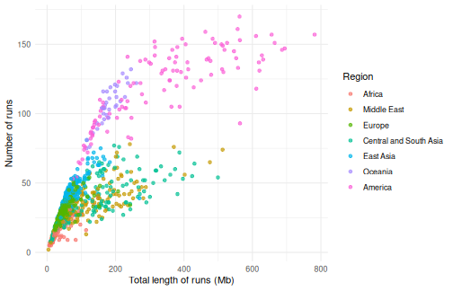
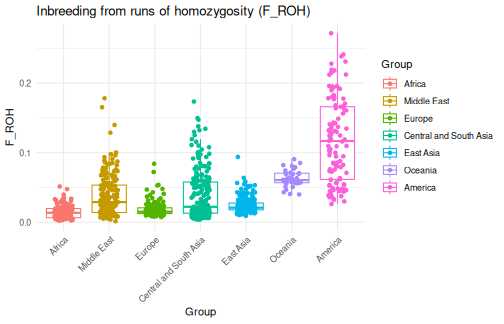
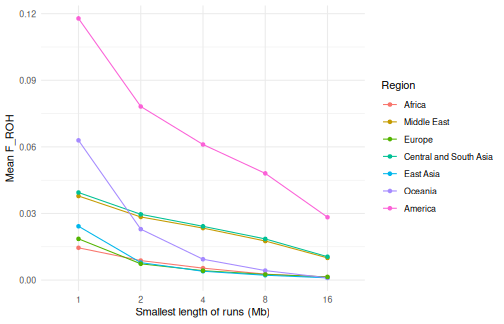
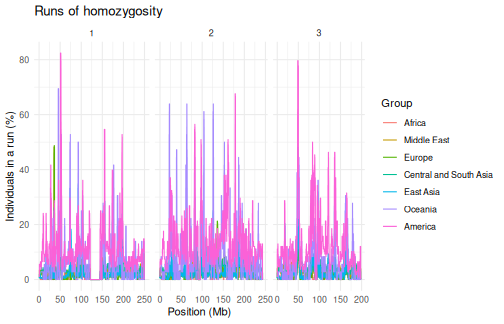
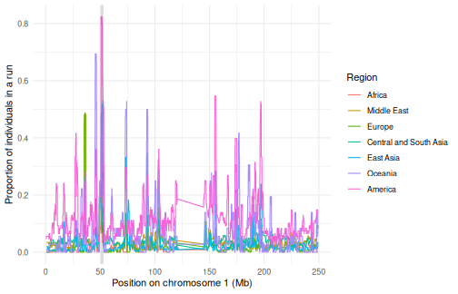

Runs of homozygosity (ROH) are stretches of the genome where both copies of
a chromosome are identical, because the individual inherited them from a
common ancestor of its parents. Their number and length tell us about the
demographic history of populations: many short runs point to a small
population in the distant past, while long runs point to recent inbreeding,
as the runs inherited from recent ancestors have had little time to be broken
up by recombination. Regions that are in runs in most individuals of a
population (ROH islands) can point to selection.

`tidypopgen` finds runs of homozygosity with the sliding-window algorithm of
PLINK 1.9 (`plink --homozyg`), with the same parameters and defaults, and
gives the same runs. In this article, we look at the runs of homozygosity of
the Human Genome Diversity Project (HGDP): 1,043 individuals from 51
populations, typed at about 650k loci. We also time each step, on a laptop
with a Intel(R) Core(TM) i7-10510U CPU @ 1.80GHz CPU.


``` r
library(tidypopgen)
#> Loading required package: dplyr
#> 
#> Attaching package: 'dplyr'
#> The following objects are masked from 'package:stats':
#> 
#>     filter, lag
#> The following objects are masked from 'package:base':
#> 
#>     intersect, setdiff, setequal, union
#> Loading required package: tibble
library(ggplot2)
n_cores <- 4
```

# The data

We download the HGDP files (see the
[HGDP benchmark](benchmark_hgdp.html) for the code) into `data/hgdp/`, and
read the bed file into a `gen_tibble`:


``` r
hgdp <- gen_tibble("./data/hgdp/hgdp650.qc.hg19.bed",
  quiet = TRUE,
  backingfile = tempfile("hgdp_")
)
```

We add the population and region of each individual, from the metadata file
of the HGDP. We use seven broad regions, which we group the individuals by:


``` r
meta_info <- readr::read_tsv("./data/hgdp/hgdp650_id_pop.txt",
  show_col_types = FALSE
)
regions <- c(
  Africa = "Africa", Middle_Est = "Middle East", Europe = "Europe",
  Central_South_Asia = "Central and South Asia", Est_Asia = "East Asia",
  Oceania = "Oceania", America = "America"
)
hgdp <- hgdp %>%
  mutate(
    population = meta_info$population[match(id, meta_info$Id)],
    region = factor(
      regions[meta_info$Pop7Groups[match(id, meta_info$Id)]],
      levels = regions
    )
  ) %>%
  group_by(region)
hgdp
#> # A gen_tibble: 643733 loci
#> # A tibble:     1,043 × 5
#> # Groups:       region [7]
#>    id        phenotype  genotypes population    region
#>    <chr>     <fct>     <vctr_SNP> <chr>         <fct> 
#>  1 HGDP00448 control    [2,0,...] Biaka_Pygmies Africa
#>  2 HGDP00479 control    [1,0,...] Biaka_Pygmies Africa
#>  3 HGDP00985 control    [0,0,...] Biaka_Pygmies Africa
#>  4 HGDP01094 control    [1,0,...] Biaka_Pygmies Africa
#>  5 HGDP00982 control    [2,0,...] Mbuti_Pygmies Africa
#>  6 HGDP00911 control    [1,0,...] Mandenka      Africa
#>  7 HGDP01202 control    [2,0,...] Mandenka      Africa
#>  8 HGDP00927 control    [2,0,...] Yoruba        Africa
#>  9 HGDP00461 control    [2,0,...] Biaka_Pygmies Africa
#> 10 HGDP00451 control    [2,0,...] Biaka_Pygmies Africa
#> # ℹ 1,033 more rows
```

# Finding runs of homozygosity

`windows_indiv_roh()` slides windows of 50 loci along each chromosome, and
finds the runs of at least 1,000 kb and 100 loci (the defaults of PLINK; see
`?windows_indiv_roh` for all the parameters). All individuals are analysed in
a single pass over the genotypes, on one or more cores:


``` r
hgdp_roh <- windows_indiv_roh(hgdp, n_cores = 1)
```


``` r
hgdp_roh <- windows_indiv_roh(hgdp, n_cores = n_cores)
```


On one core, this takes 3.8 s, and on 4
cores, 1.3 s. We get a tibble with one row per run:


``` r
hgdp_roh
#> # A tibble: 45,910 × 11
#>    group  id    chromosome  start    end length_bp n_loci first_locus last_locus
#>  * <fct>  <chr> <fct>       <int>  <int>     <int>  <int>       <int>      <int>
#>  1 Africa HGDP… 1          8.94e7 9.04e7   1006777    229       19393      19621
#>  2 Africa HGDP… 1          2.22e8 2.27e8   4360744    644       42833      43476
#>  3 Africa HGDP… 2          1.98e8 2.00e8   1684488    294       92642      92935
#>  4 Africa HGDP… 3          6.24e7 6.35e7   1125118    466      119595     120060
#>  5 Africa HGDP… 3          1.10e8 1.12e8   1547055    318      128847     129164
#>  6 Africa HGDP… 5          8.88e7 9.02e7   1372686    300      207346     207645
#>  7 Africa HGDP… 5          1.30e8 1.31e8   1438840    139      216457     216595
#>  8 Africa HGDP… 6          7.13e7 7.25e7   1184248    292      247357     247648
#>  9 Africa HGDP… 6          8.24e7 8.78e7   5450986   1090      249741     250830
#> 10 Africa HGDP… 6          8.85e7 9.00e7   1519593    416      250945     251360
#> # ℹ 45,900 more rows
#> # ℹ 2 more variables: n_het <int>, n_missing <int>
```

## Comparison with PLINK


``` r
plink_out <- tempfile("plink_roh")
system2(plink,
  c("--bfile", "./data/hgdp/hgdp650.qc.hg19", "--homozyg", "--out", plink_out),
  stdout = FALSE
)
```


``` r
plink_roh <- read.table(paste0(plink_out, ".hom"), header = TRUE)
nrow(plink_roh)
#> [1] 45910
# the same runs as PLINK
all(hgdp_roh$id == plink_roh$IID & hgdp_roh$start == plink_roh$POS1 &
  hgdp_roh$end == plink_roh$POS2 & hgdp_roh$n_loci == plink_roh$NSNP)
#> [1] TRUE
```


PLINK, run on the same machine with the default parameters, finds the same
45,910 runs in
3.6 s (reading the bed file from disk, and writing the
runs to a file). So `windows_indiv_roh()` is about as fast as PLINK on one
core, and faster on several cores; and the runs are already in R, ready to be
analysed.

# Number and length of runs

A classic way to look at runs of homozygosity is to plot, for each
individual, the number of runs against their total length. Individuals of
populations that have been small for a long time have many short runs, which
add up to a moderate total length; individuals whose parents are related
have a few very long runs, which add up to a large total length.


``` r
roh_per_indiv <- hgdp_roh %>%
  dplyr::summarise(
    n_runs = dplyr::n(),
    total_mb = sum(length_bp) / 1e6,
    .by = c(group, id)
  )
ggplot(roh_per_indiv, aes(x = total_mb, y = n_runs, colour = group)) +
  geom_point(alpha = 0.7) +
  labs(
    x = "Total length of runs (Mb)", y = "Number of runs",
    colour = "Region"
  ) +
  theme_minimal()
```



African individuals have the fewest runs (18 on average), and the smallest
total length, as African populations have been large for a long time. The
number of runs increases with the distance from Africa, as populations went
through bottlenecks while they spread out of Africa, and is largest in
Oceania and the Americas (more than 100 on average). Many Native Americans,
from small and isolated populations, have more than 200 Mb in runs. In the
Middle East and in Central and South Asia, some individuals have a large
total length from fewer, longer runs: their parents are related, as
consanguineous marriages are common in some of these populations.

# Inbreeding from runs of homozygosity

The inbreeding coefficient F_ROH is the proportion of the genome in runs of
homozygosity. `gt_roh_froh()` computes it for each individual (with 0 for
those with no runs):


``` r
hgdp_froh <- gt_roh_froh(hgdp_roh)
hgdp_froh
#> # A tibble: 1,043 × 4
#>    group  id        length_bp    froh
#>    <fct>  <chr>         <dbl>   <dbl>
#>  1 Africa HGDP00448  45652154 0.0159 
#>  2 Africa HGDP00479  99914935 0.0347 
#>  3 Africa HGDP00985  73365063 0.0255 
#>  4 Africa HGDP01094  52479955 0.0182 
#>  5 Africa HGDP00982  39329170 0.0137 
#>  6 Africa HGDP00911 114095091 0.0396 
#>  7 Africa HGDP01202  17070392 0.00593
#>  8 Africa HGDP00927  59887694 0.0208 
#>  9 Africa HGDP00461  49686281 0.0173 
#> 10 Africa HGDP00451  90687939 0.0315 
#> # ℹ 1,033 more rows
```

`autoplot()` shows F_ROH by group:


``` r
autoplot(hgdp_roh, type = "froh") +
  theme(axis.text.x = element_text(angle = 45, hjust = 1))
```



The populations with the highest mean F_ROH:


``` r
hgdp_froh %>%
  dplyr::mutate(population = hgdp$population[match(id, hgdp$id)]) %>%
  dplyr::summarise(mean_froh = mean(froh), .by = c(group, population)) %>%
  dplyr::slice_max(mean_froh, n = 8)
#> # A tibble: 8 × 3
#>   group                  population     mean_froh
#>   <fct>                  <chr>              <dbl>
#> 1 America                Surui             0.193 
#> 2 America                Karitiana         0.146 
#> 3 America                Pima              0.112 
#> 4 America                Colombians        0.0937
#> 5 Oceania                Papuan            0.0695
#> 6 Central and South Asia Balochi           0.0598
#> 7 Oceania                NAN_Melanesian    0.0571
#> 8 Central and South Asia Kalash            0.0556
```

## Recent and ancient inbreeding

Runs are broken up by recombination over the generations, so the length of
a run tells us how long ago the common ancestor lived: runs of more than 8
Mb come from ancestors a few generations back, while runs of 1 to 2 Mb come
from ancestors dozens of generations back. F_ROH computed from the runs of
at least a given length separates recent from ancient inbreeding:


``` r
froh_classes <- gt_roh_froh(hgdp_roh, min_length_mb = c(1, 2, 4, 8, 16))
froh_classes %>%
  dplyr::summarise(mean_froh = mean(froh), .by = c(group, min_length_mb)) %>%
  ggplot(aes(x = factor(min_length_mb), y = mean_froh, colour = group,
             group = group)) +
  geom_line() +
  geom_point() +
  labs(
    x = "Smallest length of runs (Mb)", y = "Mean F_ROH",
    colour = "Region"
  ) +
  theme_minimal()
```



In Oceania and East Asia, F_ROH drops quickly when only long runs are kept:
less than 10% of it comes from runs longer than 8 Mb, so it mostly reflects
small populations in the past. In the Middle East and in Central and South
Asia, almost half of F_ROH comes from runs longer than 8 Mb, from recent
inbreeding. In the Americas, F_ROH is high for runs of all lengths: these
populations were both small in the past and isolated recently.

# Where are the runs?

`autoplot()` shows the runs along each chromosome. With so many
individuals, the proportion of the individuals of each group that are in a
run (`type = "coverage"`) is easier to read than the runs themselves:


``` r
autoplot(hgdp_roh, type = "coverage", chromosome = c("1", "2", "3"))
```



## ROH islands

`gt_roh_loci()` counts, at each locus, the individuals of each group that are
in a run. `gt_roh_islands()` then finds the regions where at least a given
proportion of the individuals of a group are in a run:


``` r
hgdp_islands <- gt_roh_islands(hgdp_roh, show_loci(hgdp), threshold = 0.5)
```


``` r
hgdp_islands %>%
  dplyr::arrange(dplyr::desc(max_prop))
#> # A tibble: 57 × 10
#>    group   chromosome    start       end length_bp n_loci first_locus last_locus
#>    <fct>   <fct>         <int>     <int>     <int>  <int>       <int>      <int>
#>  1 America 1          50664611  52673307   2008697    213       10202      10414
#>  2 Oceania 6          26383386  29542947   3159562    595      237320     237914
#>  3 Oceania 22         40781162  42762024   1980863    283      640431     640713
#>  4 America 3          48197614  50144951   1947338    131      116308     116438
#>  5 Oceania 8          99383408 101150355   1766948    167      332662     332828
#>  6 America 20         32764183  34865240   2101058    220      616116     616335
#>  7 Oceania 11         30871743  32027444   1155702    138      418774     418911
#>  8 America 6          48406425  49880099   1473675    256      243385     243640
#>  9 America 22         40726762  42237769   1511008    187      640424     640610
#> 10 Oceania 1          45363887  46633874   1269988    125        9351       9475
#> # ℹ 47 more rows
#> # ℹ 2 more variables: max_prop <dbl>, mean_prop <dbl>
```

We can look at the proportion of individuals in a run along the chromosome
of the most frequent island:


``` r
top_island <- hgdp_islands %>% dplyr::slice_max(max_prop, n = 1)
roh_loci <- gt_roh_loci(hgdp_roh, show_loci(hgdp))
roh_loci %>%
  dplyr::filter(chromosome == top_island$chromosome) %>%
  ggplot(aes(x = position / 1e6, y = prop_roh, colour = group)) +
  geom_line() +
  annotate("rect",
    xmin = top_island$start / 1e6, xmax = top_island$end / 1e6,
    ymin = -Inf, ymax = Inf, alpha = 0.2
  ) +
  labs(
    x = paste("Position on chromosome", top_island$chromosome, "(Mb)"),
    y = "Proportion of individuals in a run", colour = "Region"
  ) +
  theme_minimal()
```



Islands found from a few hundred thousand SNPs should be interpreted with
care: regions with few SNPs, or with low recombination, are more likely to
be in runs, whatever selection did.

# Timings


|            |Step                                         | Time (s)|
|:-----------|:--------------------------------------------|--------:|
|read_bed    |Read the bed file (gen_tibble())             |     3.33|
|roh_1_core  |Find the runs (windows_indiv_roh(), 1 core)  |     3.77|
|roh_4_cores |Find the runs (windows_indiv_roh(), 4 cores) |     1.29|
|plink       |PLINK --homozyg (1 thread)                   |     3.55|
|froh        |F_ROH (gt_roh_froh())                        |     0.03|
|islands     |ROH islands (gt_roh_islands())               |     2.43|


