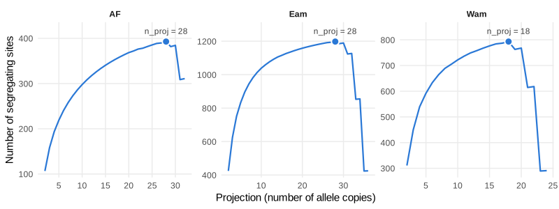
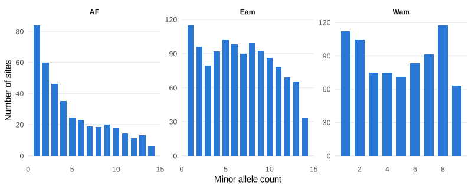
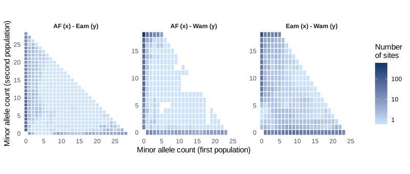
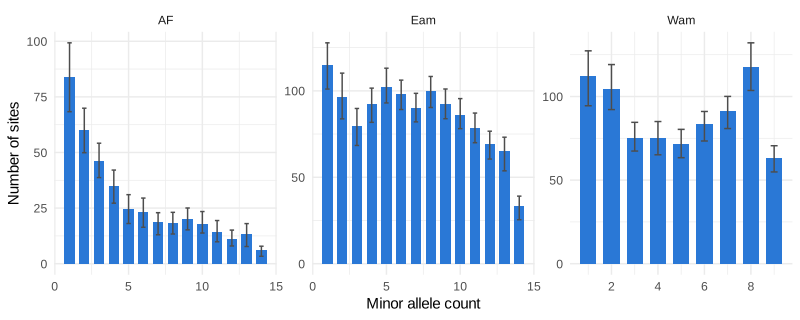

The site frequency spectrum (SFS) counts the number of sites at which an
allele is found in 1, 2, 3, ... copies in a sample. Joint spectra do the same
for several populations at once. They are the input of demographic
inference with `dadi`, `moments` or `fastsimcoal2`.

The main difficulty with real data is missing genotypes: different sites are
genotyped in a different number of individuals. `tidypopgen` deals with them
as `easySFS` does. Each population is *projected* down to a fixed number of
allele copies, by computing for every site the probability of each allele
count in a random subsample of that size. Sites with fewer genotyped copies
are dropped. This article shows the whole workflow:

1. choosing the projection;
2. computing and plotting the spectra;
3. estimating their uncertainty with a block bootstrap;
4. exporting them for `dadi` and `fastsimcoal2`.

## The data

We use the RAD-seq data of *Anolis punctatus* lizards shipped with the
package (see the vignette 'Population genetic analysis with tidypopgen').
We group the 46 individuals into three populations: the Atlantic Forest
(`AF`), and the eastern (`Eam`) and western (`Wam`) Amazonian Forest.


``` r
library(tidypopgen)
#> Loading required package: dplyr
#> 
#> Attaching package: 'dplyr'
#> The following objects are masked from 'package:stats':
#> 
#>     filter, lag
#> The following objects are masked from 'package:base':
#> 
#>     intersect, setdiff, setequal, union
#> Loading required package: tibble
vcf_path <-
  system.file("/extdata/anolis/punctatus_t70_s10_n46_filtered.recode.vcf.gz",
    package = "tidypopgen"
  )
anole_gt <-
  gen_tibble(vcf_path, quiet = TRUE, backingfile = tempfile("anolis_"))
pops_path <- system.file("/extdata/anolis/punctatus_n46_meta.csv",
  package = "tidypopgen"
)
pops <- read.csv(pops_path)
anole_gt <- anole_gt %>%
  left_join(pops, by = "id") %>%
  group_by(pop)
```

As usual for RAD-seq data, many SNPs are missing in some individuals. In the
two Amazonian populations, only about a third of the SNPs are genotyped in
every individual:


``` r
anole_gt %>%
  loci_missingness(type = "tidy") %>%
  group_by(group) %>%
  summarise(prop_complete = mean(value == 0))
#> # A tibble: 3 x 2
#>   group prop_complete
#>   <chr>         <dbl>
#> 1 AF            0.769
#> 2 Eam           0.340
#> 3 Wam           0.345
```

SNPs found on the same RAD locus are tightly linked. By default, `easySFS`
keeps a single random SNP per RAD locus. Here the RAD loci are recorded as
`chromosome`s, so we do the same with `select_loci()`:


``` r
set.seed(123)
one_per_locus <- show_loci(anole_gt) %>%
  mutate(index = row_number()) %>%
  group_by(chromosome) %>%
  slice_sample(n = 1) %>%
  pull(index)
anole_thin <- anole_gt %>% select_loci(all_of(sort(one_per_locus)))
count_loci(anole_thin)
#> [1] 1920
```

## Choosing the projection

Projecting to more allele copies gives a finer spectrum, with more rare
variants, but drops more sites with missing data. `pop_sfs_preview()`, the
equivalent of `easySFS --preview`, gives the number of segregating sites for
each possible projection of each population:


``` r
preview <- pop_sfs_preview(anole_thin)
autoplot(preview)
```



Following the `dadi` manual, a good choice maximises the number of
segregating sites. The `best` column marks that projection for each
population, which is what all the SFS functions use when `n_proj` is not
given:


``` r
preview %>% filter(best)
#> # A tibble: 3 x 5
#>   group n_proj n_seg_sites n_loci best 
#>   <chr>  <int>       <dbl>  <dbl> <lgl>
#> 1 AF        28        393.   1862 TRUE 
#> 2 Eam       28       1198.   1869 TRUE 
#> 3 Wam       18        793.   1859 TRUE
```

## One-dimensional spectra

`pop_sfs()` computes the spectrum of each population. As `n_proj` is not
given, a message reports the projections it chose:


``` r
sfs_1d <- pop_sfs(anole_thin)
#> `n_proj` not given; each group is projected to the number of allele copies that maximises its number of segregating sites (see pop_sfs_preview()): AF = 28, Eam = 28, Wam = 18
sfs_1d
#> # A tibble: 77 x 4
#>    group allele_count n_sites masked
#>    <chr>        <int>   <dbl> <lgl> 
#>  1 AF               0  1469.  TRUE  
#>  2 AF               1    83.8 FALSE 
#>  3 AF               2    60.0 FALSE 
#>  4 AF               3    46.3 FALSE 
#>  5 AF               4    35.1 FALSE 
#>  6 AF               5    24.6 FALSE 
#>  7 AF               6    23.0 FALSE 
#>  8 AF               7    19.0 FALSE 
#>  9 AF               8    18.5 FALSE 
#> 10 AF               9    20.0 FALSE 
#> # i 67 more rows
autoplot(sfs_1d)
```



The spectra are folded by default (they count copies of the minor allele),
as the ancestral allele is rarely known. With `folded = FALSE`, the
reference allele is taken to be ancestral (as in `easySFS`). You can also
give the ancestral allele of each locus, e.g. from an outgroup, with
`ancestral`. The output is a tidy tibble, with the projections stored in its
`n_proj` attribute.

The cells with no copies of the minor allele (sites monomorphic in the
projected sample), and those folded out, are `masked` (as in `dadi`). They
are not plotted by default.

## Joint spectra

`pairwise_pop_sfs()` computes the joint spectrum of each pair of
populations. Each spectrum only uses the sites with enough genotyped copies
in both of its populations. It is plotted as a heatmap, on a log scale:


``` r
n_proj <- attr(sfs_1d, "n_proj")
sfs_2d <- pairwise_pop_sfs(anole_thin, n_proj = n_proj)
autoplot(sfs_2d)
```



In all three pairs, most sites lie along the axes: their minor allele is
found in only one of the two populations. The bottom row holds the variants
of the first population that are absent from the second, and the left
column those of the second population. The top left corner holds sites
where the minor allele (across the pair) is common in the second population
but rare in the first. The interior, where the two populations share
variants at intermediate frequencies, holds fewer sites, and fewest in the
two pairs that include the Atlantic Forest.

`nwise_pop_sfs()` computes the joint spectrum of all populations. Its cells
are listed in the order of the populations, with the last one changing
fastest (use `fastest = "first"` for the opposite order):


``` r
sfs_3d <- nwise_pop_sfs(anole_thin, n_proj = n_proj)
sfs_3d
#> # A tibble: 15,979 x 5
#>       AF   Eam   Wam       n_sites masked
#>    <int> <int> <int>         <dbl> <lgl> 
#>  1     0     0     0  0.0000000719 TRUE  
#>  2     0     0     1  0.00000284   FALSE 
#>  3     0     0     2  0.0000732    FALSE 
#>  4     0     0     3  0.00534      FALSE 
#>  5     0     0     4  0.122        FALSE 
#>  6     0     0     5  1.27         FALSE 
#>  7     0     0     6  6.63         FALSE 
#>  8     0     0     7 20.1          FALSE 
#>  9     0     0     8 35.9          FALSE 
#> 10     0     0     9 42.6          FALSE 
#> # i 15,969 more rows
```

With `type = "array"`, all these functions return arrays (`sfs` objects)
instead of tibbles.

## Uncertainty: block bootstrap

`bootstrap_pop_sfs()`, `bootstrap_pairwise_pop_sfs()` and
`bootstrap_nwise_pop_sfs()` resample blocks of loci with replacement. The
blocks are defined as in the `jackknife_*` functions: SNPs, base pairs or
centiMorgans, never spanning two chromosomes. Blocks should be larger than
the extent of linkage disequilibrium. Here we kept a single SNP per RAD
locus, and RAD loci are not mapped, so we resample single SNPs
(`block_size = 1`):


``` r
set.seed(42)
boot <- bootstrap_pop_sfs(anole_thin,
  n_bootstrap = 100, block_size = 1,
  n_proj = n_proj
)
boot
#> # A tibble: 7,700 x 5
#>    group replicate allele_count n_sites masked
#>    <chr>     <int>        <int>   <dbl> <lgl> 
#>  1 AF            1            0  1438.  TRUE  
#>  2 AF            1            1    90.6 FALSE 
#>  3 AF            1            2    65.8 FALSE 
#>  4 AF            1            3    47.5 FALSE 
#>  5 AF            1            4    26.7 FALSE 
#>  6 AF            1            5    21.2 FALSE 
#>  7 AF            1            6    24.9 FALSE 
#>  8 AF            1            7    20.4 FALSE 
#>  9 AF            1            8    20.9 FALSE 
#> 10 AF            1            9    24.8 FALSE 
#> # i 7,690 more rows
```

The genotypes are read only once, whatever the number of replicates. We can
then add a 95% interval to each cell of the spectra:


``` r
library(ggplot2)
boot_ci <- boot %>%
  filter(!masked) %>%
  group_by(group, allele_count) %>%
  summarise(
    lower = quantile(n_sites, 0.025),
    upper = quantile(n_sites, 0.975),
    .groups = "drop"
  )
sfs_1d %>%
  filter(!masked) %>%
  left_join(boot_ci, by = c("group", "allele_count")) %>%
  ggplot(aes(x = allele_count, y = n_sites)) +
  geom_col(fill = "#2a78d6", width = 0.7) +
  geom_errorbar(aes(ymin = lower, ymax = upper),
    width = 0.3, colour = "grey30"
  ) +
  # integer breaks for allele counts
  scale_x_continuous(breaks = function(x) unique(floor(pretty(x)))) +
  facet_wrap(~group, scales = "free") +
  labs(x = "Minor allele count", y = "Number of sites") +
  theme_minimal()
```



## Exporting to dadi and fastsimcoal2

`gt_as_easysfs()` writes all the spectra that `easySFS` writes, in a single
pass over the genotypes:
- the 1D spectrum of each population;
- the joint spectrum of each pair;
- the joint spectrum of all populations.

They are written in both `dadi` and `fastsimcoal2` formats, with the same
file names as `easySFS`. With `n_bootstrap`, it also writes each bootstrap
replicate in its own sub-directory, e.g. to estimate confidence intervals of
the parameters fitted with `fastsimcoal2`:


``` r
out_dir <- file.path(tempdir(), "anolis_sfs")
files <- gt_as_easysfs(anole_thin,
  out_dir = out_dir, n_proj = n_proj,
  prefix = "anolis", n_bootstrap = 10, bootstrap_block_size = 1
)
list.files(out_dir)
#>  [1] "bootstrap_01" "bootstrap_02" "bootstrap_03" "bootstrap_04" "bootstrap_05"
#>  [6] "bootstrap_06" "bootstrap_07" "bootstrap_08" "bootstrap_09" "bootstrap_10"
#> [11] "dadi"         "fastsimcoal2"
list.files(file.path(out_dir, "fastsimcoal2"))
#> [1] "AF_MAFpop0.obs"            "Eam_MAFpop0.obs"          
#> [3] "Wam_MAFpop0.obs"           "anolis_MSFS.obs"          
#> [5] "anolis_jointMAFpop1_0.obs" "anolis_jointMAFpop2_0.obs"
#> [7] "anolis_jointMAFpop2_1.obs"
```

`total_length` sets the number of monomorphic sites from the total length
of the sequenced data, as `easySFS --total-length` does. A single spectrum
can be written with `write_sfs()`:


``` r
sfs_eam_wam <- pairwise_pop_sfs(anole_thin,
  n_proj = n_proj,
  type = "array"
)$Eam.Wam
dadi_file <- tempfile(fileext = ".sfs")
write_sfs(sfs_eam_wam, dadi_file, format = "dadi")
substr(readLines(dadi_file), 1, 60)
#> [1] "29 19 folded \"Eam\" \"Wam\""                                
#> [2] "93.44084756594708 2.558089120183719 0.9633016722515982 0.123"
#> [3] "1 0 0 0 0 0 0 0 0 0 0 0 0 0 0 0 0 0 0 0 0 0 0 0 0 0 0 0 0 0 "
```
